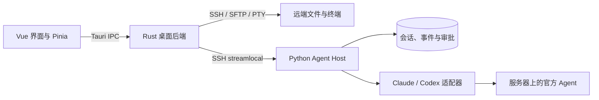

# 代码结构与运行流程

AgentDesk 是一个单仓库项目，包含桌面界面、桌面后端、服务器 Host 和三端共享协议。主要使用方式是项目与官方 Agent 位于 VPS，桌面通过 SSH 访问。

## 模块职责

| 目录                            | 职责与入口                                                                                                                |
| ------------------------------- | ------------------------------------------------------------------------------------------------------------------------- |
| `src/`                          | Vue 界面。`main.ts` 初始化应用，`router/` 定义页面，`views/` 组合工作流，`components/` 提供交互组件，`stores/` 管理状态。 |
| `src-tauri/src/commands/`       | 桌面 IPC 边界，校验目标归属并分派连接、项目、文件、会话、终端和安装请求。                                                 |
| `src-tauri/src/ssh/`            | SSH 认证、主机指纹、通道、PTY、SFTP 和传输生命周期。                                                                      |
| `src-tauri/src/host/`           | Host 安装、升级、连接与消息转发。                                                                                         |
| `src-tauri/src/local/`          | 可选的本机文件、终端及反向执行通道；需要显式授权。                                                                        |
| `src-tauri/src/platform/`       | Windows / Unix 平台实现。平台细节不进入 Vue 组件。                                                                        |
| `src-tauri/src/db/`             | 桌面连接、项目索引、目标映射和草稿；秘密使用系统凭据库。                                                                  |
| `host/agentdesk_host/server/`   | Host 生命周期、Unix socket、RPC 调度、登录与业务状态。入口为 `host/agentdesk_host/__main__.py`。                          |
| `host/agentdesk_host/adapters/` | 官方 Agent 适配器和用于验收的 Fake Adapter。界面不直接调用模型服务。                                                      |
| `host/agentdesk_host/store/`    | Host SQLite、事件序号和保留策略。                                                                                         |
| `host/agentdesk_host/device/`   | 可选本机执行通道的服务器端控制。                                                                                          |
| `host/agentdesk_host/runtime/`  | 可选容器运行环境。普通远端项目不依赖此模块的容器前置条件。                                                                |
| `protocol/`                     | JSON Schema、协议样例与三端类型生成器。                                                                                   |
| `resources/`                    | 随包资源说明与本机构建产物；下载的二进制不提交到 Git。                                                                    |

## 关键流程

### 连接与文件

连接页通过 `commands/conn.rs` 调用 SSH 管理器。首次连接需要确认主机指纹；变化时拒绝连接。远端文件与终端请求保留创建时的连接和项目归属，由 Rust 直接走 SFTP 或 PTY。

### Agent 会话

聊天状态由 `src/stores/chat.ts` 管理，经 `commands/session.rs` 和 `host/client.rs` 进入服务器 Host。Host 保存会话、运行、审批和事件，再调用对应适配器启动官方 Agent。桌面显示历史不用于重建原生 Agent 上下文。

### 登录

`src/stores/login.ts` 管理登录对话框和能力缓存。Rust 将请求送到对应 Host；Host 启动官方登录流程。授权链接和代码仅通过实时通知转交，不进入聊天事件数据库。隔离项目的登录状态按项目独立保存。

### 可选执行方式

普通远端项目使用服务器目录和服务器工具链。本机项目另需显式开启反向执行通道。容器工作区另需服务器满足 rootless Podman 等前置条件；失败时拒绝执行，不自动改变项目运行方式。

## 修改边界

- 异步操作核对 `(connectionId, projectId, sessionId, requestSeq)`，迟到响应不得改变新的目标。
- 协议先改 `protocol/*.schema.json`，再运行生成器；不手改生成类型。
- UI 文案进入 `src/i18n/`。权限、持久化与连接归属校验保留在对应后端边界。
- 新功能使用已有的路由、状态管理和适配器入口，避免在组件中增加独立网络或进程调用。

接口细节见 [桌面 IPC 契约](IMPLEMENTATION-CONTRACT.md)、[Host 契约](M2-CONTRACT.md)、[本机执行契约](M3-CONTRACT.md) 和 [可选隔离工作区](ISOLATION-CONTRACT.md)。
